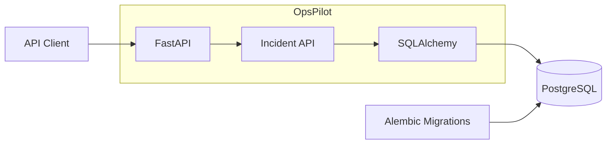
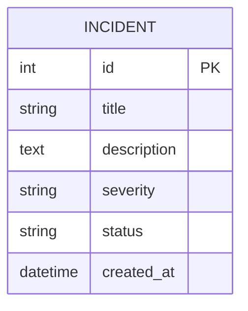
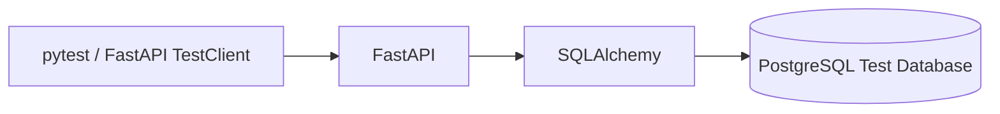
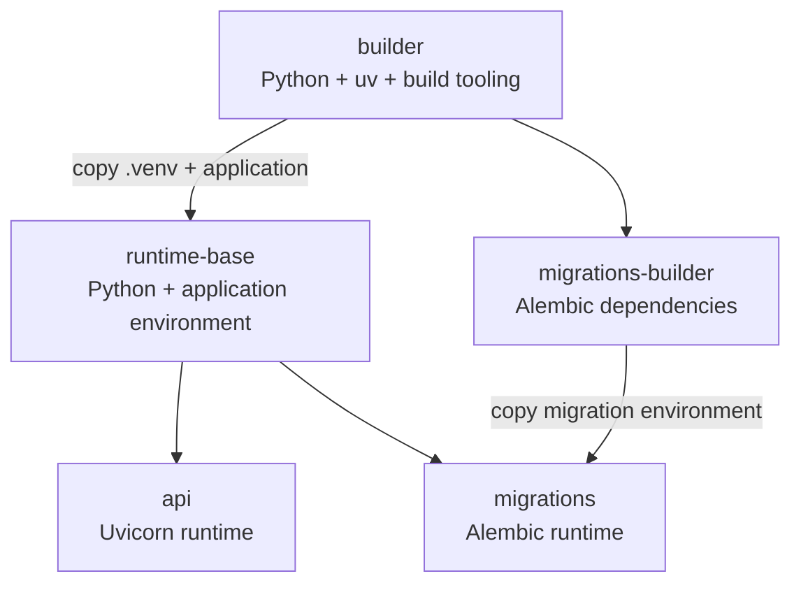
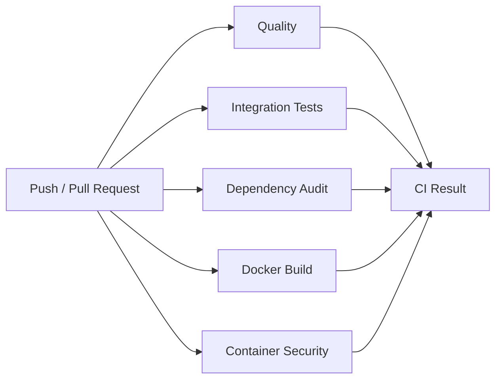
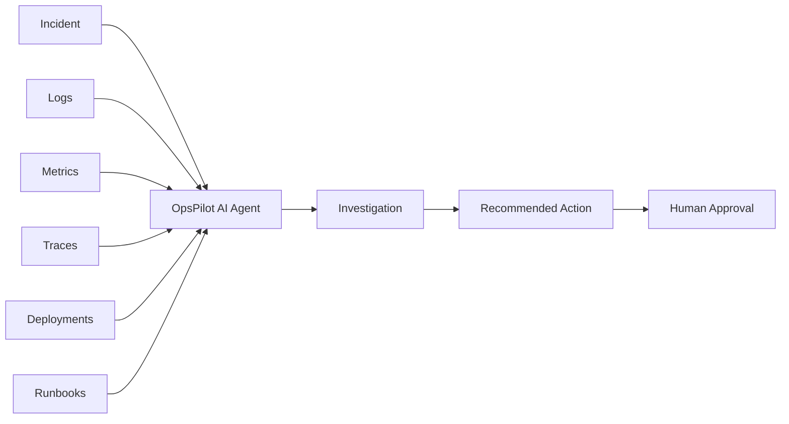

# OpsPilot

OpsPilot is an AI-assisted incident and operations platform built as a hands-on Cloud, DevOps, and AI engineering project.

The platform currently provides a REST API for managing incidents. Over time, it will evolve into an operations platform capable of investigating incidents using logs, metrics, deployments, runbooks, and AI-assisted reasoning.

The project is intentionally developed incrementally, starting with a small modular application and introducing additional infrastructure and architectural complexity only when it provides a clear benefit.

---

## Current Status

OpsPilot currently provides:

- FastAPI-based REST API
- PostgreSQL persistence
- Incident creation and retrieval
- Database migrations with Alembic
- Dockerized application and database
- Multi-stage production container builds
- Automated integration tests
- Static code quality checks
- Dependency vulnerability scanning
- Container vulnerability scanning
- GitHub Actions CI pipeline

The project is under active development.

---

## Architecture

OpsPilot currently follows a **modular monolith** architecture.

This keeps the system simple while the domain is still evolving. Services may be separated later when there is a concrete operational or architectural reason to do so.



The architecture will evolve as additional capabilities such as observability, authentication, event processing, and AI-assisted incident investigation are introduced.

---

## Data Model

The current domain contains a single main entity: `Incident`.



### Incident Severity

Supported severity values:

- `LOW`
- `MEDIUM`
- `HIGH`
- `CRITICAL`

### Incident Status

Supported status values:

- `OPEN`
- `IN_PROGRESS`
- `RESOLVED`

The data model will later be extended with entities such as applications, deployments, investigations, runbooks, and operational signals.

---

## Technology Stack

### Application

- Python 3.14
- FastAPI
- Pydantic
- SQLAlchemy
- Psycopg
- Uvicorn

### Database

- PostgreSQL 18
- Alembic

### Development Tooling

- uv
- pytest
- Ruff
- mypy
- Bandit
- pip-audit

### Containerization and Security

- Docker
- Docker Compose
- Trivy

### CI

- GitHub Actions

---

## Project Structure

```text
opspilot/
├── .github/
│   └── workflows/
│       └── ci.yml
│
├── .vscode/
│   ├── launch.json
│   ├── settings.json
│   └── tasks.json
│
├── alembic/
│   ├── versions/
│   ├── env.py
│   └── script.py.mako
│
├── docker/
│   └── postgres/
│       └── init-test-db.sql
│
├── scripts/
│   ├── check.sh
│   ├── check-all.sh
│   └── check-container.sh
│
├── src/
│   └── opspilot/
│       ├── api/
│       │   └── incidents.py
│       ├── database.py
│       ├── db_models.py
│       ├── main.py
│       ├── models.py
│       └── settings.py
│
├── tests/
│   └── test_api.py
│
├── .dockerignore
├── .env.example
├── .env.test.example
├── .gitignore
├── .python-version
├── alembic.ini
├── compose.yaml
├── Dockerfile
├── pyproject.toml
├── README.md
└── uv.lock
```

---

## Prerequisites

The local development environment requires:

- Docker
- Docker Compose
- Python 3.14
- uv

Verify the installation:

```bash
docker --version
docker compose version
uv --version
```

---

## Configuration

OpsPilot uses environment files for local configuration.

Create the local application configuration from the example:

```bash
cp .env.example .env
```

Create the test configuration:

```bash
cp .env.test.example .env.test
```

The real environment files are intentionally excluded from Git.

Do not commit credentials or secrets.

---

## Running OpsPilot

Build and start the complete local environment:

```bash
docker compose up -d --build
```

Check the current state:

```bash
docker compose ps
```

The API is available at:

```text
http://localhost:8000
```

FastAPI documentation:

```text
http://localhost:8000/docs
```

Alternative ReDoc documentation:

```text
http://localhost:8000/redoc
```

Stop the environment:

```bash
docker compose down
```

To remove the PostgreSQL volume as well:

```bash
docker compose down -v
```

> Removing the volume permanently deletes the local database data.

---

## API

### Health

```http
GET /health
```

Example response:

```json
{
  "status": "ok"
}
```

### Create Incident

```http
POST /incidents
```

Example request:

```json
{
  "title": "Database unavailable",
  "description": "The application cannot connect to PostgreSQL.",
  "severity": "CRITICAL"
}
```

### List Incidents

```http
GET /incidents
```

### Get Incident

```http
GET /incidents/{incident_id}
```

Unknown incident IDs return HTTP `404`.

---

## Database Migrations

Database schema changes are managed using Alembic.

The migration container automatically applies migrations when the Docker Compose environment starts.

To inspect the current migration state locally:

```bash
uv run --group migrations alembic current
```

Create a new migration:

```bash
uv run --group migrations alembic revision --autogenerate -m "describe migration"
```

Apply migrations:

```bash
uv run --group migrations alembic upgrade head
```

Migration files are stored under:

```text
alembic/versions/
```

Database schema changes should always be represented by migrations instead of manually modifying production schemas.

---

## Testing

The current automated API tests are **integration tests**.

They exercise the request flow across multiple components:



This verifies the integration between:

- HTTP request handling
- FastAPI routing
- request and response validation
- application logic
- SQLAlchemy
- PostgreSQL

Current scenarios include:

- health endpoint
- incident creation
- incident retrieval
- handling unknown incident IDs

Start PostgreSQL before running the test suite:

```bash
docker compose up -d postgres
```

Then execute:

```bash
uv run pytest
```

Unit tests will be introduced as business logic is extracted into dedicated domain or service components that can be tested independently from infrastructure.

A future test structure may look like:

```text
tests/
├── unit/
├── integration/
└── e2e/
```

---

## Code Quality

Run the standard local quality checks:

```bash
./scripts/check.sh
```

The check includes:

1. Ruff linting
2. Ruff formatting validation
3. mypy type checking
4. Bandit security analysis
5. pytest integration tests
6. pip-audit dependency vulnerability scanning

The script stops immediately if one check fails.

---

## Container Security

The production container image can be built and scanned locally using:

```bash
./scripts/check-container.sh
```

The script:

1. builds the production API image
2. scans the resulting image with Trivy
3. checks for fixable `HIGH` and `CRITICAL` vulnerabilities
4. fails if such a vulnerability is detected

Run all local checks together:

```bash
./scripts/check-all.sh
```

The checks are also available as project-specific VS Code tasks.

---

## Container Architecture

OpsPilot uses a multi-stage Docker build to separate build tooling from the production runtime.



The production API image is intentionally kept minimal.

It:

- runs as a non-root user
- does not contain `uv`
- does not contain `pip`
- contains only runtime dependencies
- uses a dedicated virtual environment
- is scanned for known vulnerabilities

Build tooling remains in intermediate Docker stages and is not included in the final runtime image.

---

## Continuous Integration

GitHub Actions automatically validates changes on pushes to `main` and pull requests.

The CI pipeline currently contains separate jobs for:

### Quality

- Ruff linting
- Ruff formatting validation
- mypy
- Bandit

### Tests

- PostgreSQL test service
- API integration tests with pytest

### Dependency Audit

- pip-audit

### Docker Build

- API image build
- migration image build

### Container Security

- production API image build
- Trivy vulnerability scan
- CI failure for fixable `HIGH` or `CRITICAL` vulnerabilities



The jobs intentionally run independently to keep responsibilities clearly separated.

---

## Security Principles

The project follows several basic security principles from the beginning:

- no secrets committed to Git
- environment-specific configuration
- non-root containers
- minimal runtime images
- dependency vulnerability scanning
- container vulnerability scanning
- static security analysis
- reproducible dependency resolution through `uv.lock`
- automated security checks in CI

Additional controls will be introduced as the platform evolves.

---

## Development Principles

OpsPilot is built around several engineering principles:

### Keep the architecture simple

Start with a modular monolith and introduce distributed components only when justified.

### Automate quality early

Formatting, linting, type checking, tests, and security checks should be automated rather than relying on manual discipline.

### Build once, deploy consistently

Container images should become immutable deployment artifacts.

Future environments will promote the same artifact through:

```text
dev → test → production
```

instead of rebuilding the application for every environment.

### Infrastructure as Code

Cloud infrastructure will be managed declaratively rather than manually.

### Security by design

Security checks should be part of normal development and CI/CD workflows instead of being added shortly before production.

---

## Roadmap

The project will evolve incrementally.

Planned areas include:

### Application Architecture

- service and domain layers
- repository abstraction where useful
- additional operational entities
- improved test separation

### Cloud

- Microsoft Azure
- Azure Container Registry
- Azure Kubernetes Service
- managed PostgreSQL
- Azure Key Vault
- workload identities

### Infrastructure as Code

- Terraform / OpenTofu
- environment separation
- reusable infrastructure modules

### Kubernetes

- Kubernetes deployments
- Services
- ConfigMaps
- Secrets
- health probes
- resource management
- Helm
- Kustomize
- GitOps with Argo CD

### Observability

- Prometheus
- Grafana
- centralized logging
- OpenTelemetry
- tracing
- dashboards
- alerts
- SLOs

### Security

- authentication with OIDC / OAuth2
- role-based access control
- secret management
- TLS
- container and dependency scanning
- SBOM generation
- policy enforcement
- image signing and software supply-chain controls

### Event-Driven Architecture

Introduce asynchronous messaging if operational requirements justify it.

Possible technologies include:

- Kafka
- NATS
- RabbitMQ

### AI-assisted Operations

OpsPilot will eventually support an AI operations agent capable of using operational context such as:

- incidents
- logs
- metrics
- traces
- deployments
- runbooks

Potential capabilities include:

- incident investigation
- root-cause suggestions
- Retrieval-Augmented Generation
- tool access using MCP
- remediation recommendations
- human-approved operational actions
- AI cost and token observability

AI functionality will be introduced only after the underlying operational platform provides the required data and interfaces.

---

## Long-Term Vision

The long-term goal is to evolve OpsPilot from a simple incident API into an AI-assisted operations platform.

A future investigation flow may look like:



Operational actions that can affect production systems should remain subject to explicit authorization and appropriate human approval.

---

## License

No license has been selected yet.